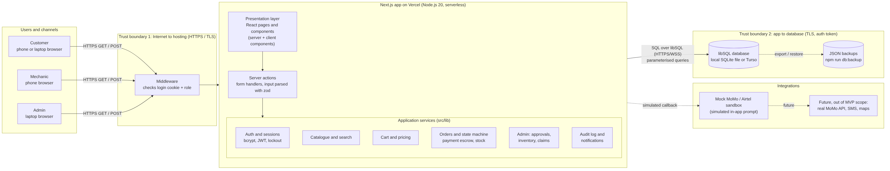
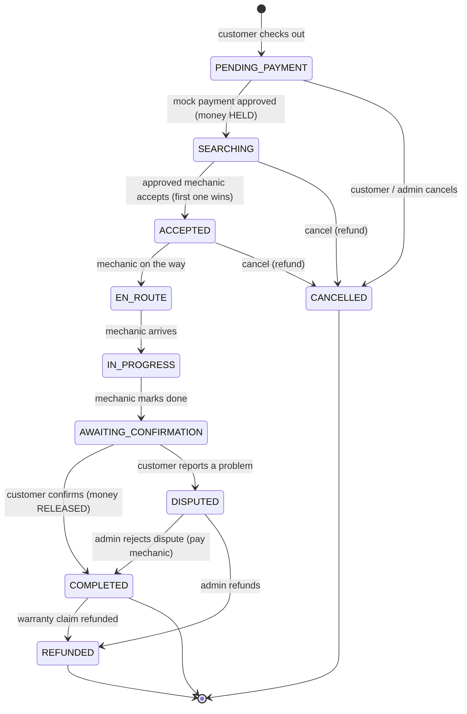

# Architecture

The diagram source is in [`diagrams/architecture.mmd`](diagrams/architecture.mmd). It renders on GitHub, and `npx @mermaid-js/mermaid-cli -i architecture.mmd -o architecture.png` re-creates the picture.

## Layers

| Layer | What it is | Where in the code |
|---|---|---|
| **Users / channels** | Customers, mechanics and admins use a web browser on a phone or laptop. The layout is responsive, so no app install is needed. A USSD/WhatsApp channel is planned for basic phones (future). | - |
| **Edge / first gate** | Next.js middleware checks the signed login cookie and the user's role before any protected page loads. | `src/middleware.js` |
| **Presentation** | React pages rendered on the server, plus small client components for forms, live refresh and buttons. | `src/app/**/page.js`, `src/components/` |
| **Application / services** | Server actions receive form posts, validate them with zod and call the service modules. All business rules live here, not in the UI. | `src/app/actions/`, `src/lib/` |
| **Integrations** | Mock mobile-money: an in-app "phone prompt" simulates MTN MoMo / Airtel Money approval with a fake sandbox reference. Real APIs (MoMo, SMS, maps) are out of MVP scope. | `src/lib/orders.js` (`approveMockPayment`) |
| **Data store** | libSQL (SQLite). Locally a file in `data/`; when hosted, a Turso database. Backups are JSON exports. | `database/schema.sql`, `src/lib/db.js`, `scripts/` |

## Trust boundaries

1. **Browser ↔ app (Internet).** Everything here is untrusted, so every input is validated on the server. HTTPS (TLS) is provided by Vercel. The session cookie is `httpOnly`, `SameSite=Lax` and `Secure` in production. Security headers (CSP, HSTS, X-Frame-Options and more) are set in `next.config.mjs`.
2. **App ↔ database.** Only the server can reach the database, using a secret token (`DATABASE_AUTH_TOKEN`) over TLS. All queries use **parameterised SQL** (`?` placeholders), never string-built SQL from user input.
3. **App ↔ payment provider (simulated).** In the prototype, approval happens inside our own trust boundary. In production this becomes a callback from the provider and must be verified with the provider's signature (see SECURITY.md, future work).

## Protocols

| From → To | Protocol |
|---|---|
| Browser → app | HTTPS. Pages via `GET`, form submissions via `POST` (Next.js server actions, same-origin only) |
| Live updates | The page refreshes its server data every 5-15 s (`router.refresh()` over HTTPS) |
| App → database | libSQL over HTTPS/WebSockets (Turso), or a local file |
| Admin → backups | `npm run db:backup` / `db:restore` (JSON files) |

## Deployment assumptions

- Hosted on **Vercel** (serverless Node.js 20) with a **Turso** free-tier database, single region.
- Local mode (a SQLite file) works fully offline, as the exam's offline fallback for the demo.
- Up to roughly tens of concurrent users for the pilot. The local file database queues writes one at a time (see `src/lib/db.js`), while Turso handles concurrency itself.
- Time is stored in UTC and shown in Kampala time (EAT, UTC+3).

## Key design decisions

- **Order state machine** (`src/lib/constants.js`, `TRANSITIONS`). Each status change states which role may make it. Every update is written as `UPDATE ... WHERE id = ? AND status = <expected>`, so two people can never make conflicting changes, for example when two mechanics accept the same job (test TC13).
- **Escrow.** Payment goes `PENDING → HELD` when paid, and `HELD → RELEASED` only when the customer confirms, or `→ REFUNDED` on cancellation or refund.
- **Idempotent payment.** One payment per order (unique `order_id` and `idempotency_key`), and approving twice does nothing the second time (test TC04).
- **Inventory inside the transaction.** Stock is decremented with `WHERE stock >= qty` inside the same transaction as the order. If any part is short, the whole order is rolled back (test TC09).

