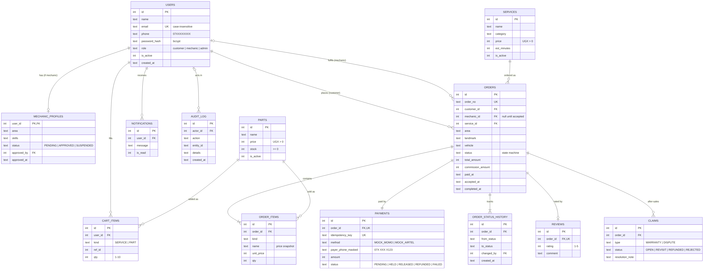

# Data design

The full schema with every constraint is in [`../database/schema.sql`](../database/schema.sql).

## Entities and relationships

| Entity | Identifier | Key relationships (cardinality) | Purpose |
|---|---|---|---|
| `users` | `id` (PK), `email` (unique) | 1 user → 0..1 provider profile or 0..1 customer profile; 1 customer → 0..* orders; 1 helper → 0..* orders | Everyone who logs in (customer, mechanic, driver, admin) |
| `provider_profiles` | `user_id` (PK + FK) | 1 : 1 with a mechanic or driver user (`users.role` says which) | Work area, skills or licence/experience, approval status (mock verification), online flag, illustrated avatar style |
| `customer_profiles` | `user_id` (PK + FK) | 1 : 1 with a customer | Saved car (make, model, type, colour) and the last area asked from, to make the next request faster |
| `services` | `id` | 1 service → 0..* orders | Catalogue with fixed prices; `provider_type` = who does it (mechanic or driver) |
| `garages` | `id` | none (shown on the map) | Partner garages: area, landmark, map position (a business address, not personal data), specialties, hours, rating |
| `parts` | `id` | 1 part → 0..* cart items / order items | Spare parts with stock |
| `cart_items` | `id`; unique (`user_id`, `kind`, `ref_id`) | many → 1 user | Saved cart (one service + parts) |
| `orders` | `id`, `order_no` (unique) | 1 order → 1..* items, 1 payment, 1..* history rows, 0..1 review, 0..* claims | The roadside job |
| `order_items` | `id` | many → 1 order | Price snapshot at time of order |
| `payments` | `id`; unique `order_id`, unique `idempotency_key` | 1 : 1 with order | Mock payment and escrow status |
| `order_status_history` | `id` | many → 1 order | Every status change (tracking + audit) |
| `reviews` | `id`; unique `order_id` | 0..1 per order | Rating 1-5 and comment |
| `claims` | `id` | 0..* per order | Warranty claims and disputes |
| `notifications` | `id` | many → 1 user | In-app alerts |
| `audit_log` | `id` | many → 0..1 user | Who did what, when |

## Validation (defence in two places)

1. **Application layer** (`src/lib/validation.js`, zod): name length, email format, Ugandan phone format `07XXXXXXXX`, password at least 8 characters with a letter and a number, area from a fixed list, landmark 5-120 characters, no `<` or `>` in free text, rating 1-5, quantity 1-10, stock 0-10,000.
2. **Database layer** (`CHECK`, `UNIQUE`, `NOT NULL`, `FOREIGN KEY` in `schema.sql`): prices > 0, `stock >= 0`, status values limited to the allowed list, one review and one payment per order, case-insensitive unique email.

## Data minimisation decisions

| We do NOT store | Why | What we store instead |
|---|---|---|
| Mobile-money PIN / OTP | Not needed, and forbidden by the exam rules | Nothing |
| Full payer phone number | Not needed after payment | Masked `07X XXX X123` |
| National ID number / ID photos | High risk; the exam forbids real identity data | Admin approval status (mock verification) |
| Exact GPS coordinates | Location history is sensitive | Area + a landmark typed by the customer. "Use my location" runs in the browser only and sends just the nearest area name. Helpers are drawn near their area's centre, never at a real position |
| Photos of people | Not needed; biometric-adjacent data | Illustrated avatars generated from the user id (`src/lib/avatar.js`) |
| Card numbers | Not used | Nothing |
| Plain-text passwords | Security | bcrypt hash (cost 10) |

## Retention

| Data | Kept for | Reason |
|---|---|---|
| Orders, items, payments, history | 2 years | Warranty, disputes, accounting |
| Reviews | While the mechanic is active | Trust and ratings |
| Claims | 2 years | Dispute evidence |
| Audit log | 12 months | Security investigations |
| Notifications | 90 days | Only short-term use |
| Cart items | Until checkout or 30 days | Convenience |
| Closed accounts | Personal fields removed; orders kept anonymously | Right to be forgotten vs accounting |

A scheduled clean-up job for these periods is listed as future work. The prototype only holds fictitious data.

## Sample data

`src/lib/setup.js` loads fictitious demo data: 13 users (1 admin, 2 customers, 6 mechanics, 4 drivers), 14 services, 8 parts, 10 partner garages, 9 completed orders with reviews, and 2 live orders (one waiting for a mechanic, one for a driver). All emails use the `.test` domain, which can never receive real email.

**Upgrading from 1.0:** `npm run dev` notices a database without the new tables, copies the old file to `data/roadrescue-before-1.1-<time>.db`, and rebuilds it with the new demo data. A hosted Turso database is never rebuilt automatically: run `npm run db:reset`. Old JSON backups can still be restored (their `mechanic_profiles` rows are loaded into `provider_profiles`).
