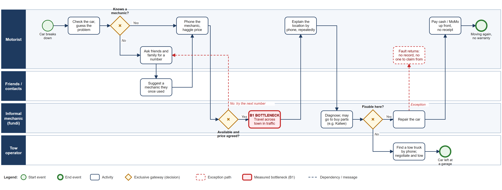
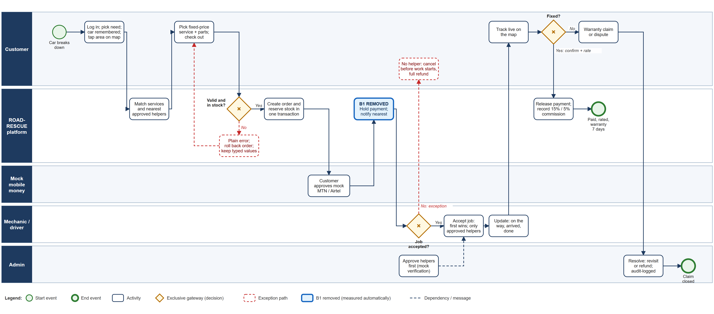

# Process models (BPMN 2.0 style)

Both diagrams use swimlanes per role, start and end events, activities, exclusive gateways (decisions) and exception paths. The PNG files are for reading; the SVG files are the editable sources, and `diagrams/process-models.js` re-creates both (it needs `playwright-core` and Microsoft Edge).

## Current (as-is) process

The motorist depends on phone referrals to informal mechanics. If the mechanic is busy or the price is not agreed, the motorist loops back to asking friends for another number. The mechanic then crosses town in traffic. If the car can't be fixed on the spot, the motorist must find a tow truck separately. Payment is up front with no receipt, and if the fault returns there is no record and no one to claim from.

## Measured bottleneck B1: time-to-help

| Item | Definition |
|---|---|
| Bottleneck | Minutes from the moment a motorist decides to get help until a helper is on site |
| Today | Not recorded anywhere; a pilot would measure it with a consent-based survey |
| In ROADRESCUE | Measured automatically from order timestamps: `paid_at` -> `accepted_at` -> the `IN_PROGRESS` entry in `order_status_history` (helper has arrived) -> `completed_at` |
| How it is reduced | No search and no price negotiation (fixed prices, one tap); the nearest approved helpers are shown and notified; map + landmark replace repeated location calls |
| Supporting measures | Phone calls needed (target 0); share of jobs accepted within 10 minutes; share completed without dispute; cancellations because nobody accepted |

## Proposed (to-be) process

| Gateway | Outcome A | Outcome B (exception) |
|---|---|---|
| Valid input and in stock? | Order created, stock reserved | Plain-language error, order rolled back, typed values kept (TC08, TC09) |
| Payment approved? | Payment HELD, status SEARCHING | Payment FAILED, customer can retry (idempotent, TC04) |
| Job accepted? | Helper assigned (first wins, TC13) | Customer cancels before work starts and is refunded (TC07) |
| Fixed? | Payment RELEASED, review (TC05, TC06) | Warranty claim or dispute, admin resolves (TC06) |
